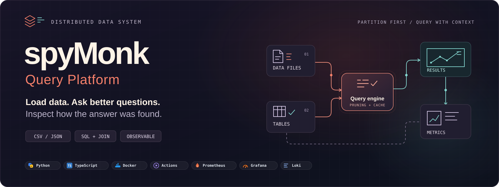

<p align="center">
  
</p>

# spyMonk Query Platform

**Load data. Ask better questions. Inspect how the answer was found.**

spyMonk Query Platform is an experimental, self-hosted data system for turning files into queryable tables. It pairs a Spanner-inspired storage engine with a Snowflake-inspired analytical workspace, so you can ingest tabular data, run safe read-only SQL, understand the work performed for a query, and operate the stack with metrics and logs.

[Installation & deployment](docs/installation/README.md) · [Database architecture](spyMonk-DB/docs/ARCHITECTURE.md) · [Warehouse API & internals](spyMonk-warehouse/README.md) · [Deployment roadmap](DEPLOYMENT_ROADMAP.md)

## What you can do

| Capability | What it gives you |
| --- | --- |
| **Load tabular data** | Upload CSV, JSON, or XLSX files. Each upload becomes a named table with its schema, row count, source format, and a preview available in the workspace. |
| **Query safely** | Run `SELECT` queries, including joins, subqueries, and CTEs supported by the warehouse executor. The API rejects writes and dangerous statement forms. |
| **Explore tables** | Browse available tables, inspect columns and recent query history, view table contents, and delete a table when it is no longer needed. |
| **Export results** | Download query results from the browser as CSV, JSON, or XLSX. |
| **Use an optional SQL assistant** | Ask an OpenAI-compatible provider to generate SQL from plain English, improve a query, or help correct the last error. Suggestions are constrained to a single `SELECT` statement and still pass server-side validation. |
| **Avoid unnecessary reads** | Data is stored as columnar micro-partitions with per-column zone maps. The query service can skip partitions that cannot satisfy a predicate, then reports scanned versus total partitions. |
| **Reuse valid results** | A version-aware result cache keys entries to normalized SQL and the versions of every referenced table. Uploading or deleting a table makes stale cache entries unreachable. |
| **Observe the system** | Inspect request, database, and query metrics through Prometheus; use the provided Loki, Promtail, and Grafana configuration for local logs and dashboards. |

## How it works

```text
CSV / JSON / XLSX
        │
        ▼
FastAPI ingestion ──► versioned columnar micro-partitions + zone maps
                                      │
                                      ▼
SQL query ──► table/predicate extraction ──► partition selection
                                      │
                                      ▼
                          in-memory SQLite execution ──► result cache ──► results
```

1. **Ingest.** The warehouse parses an accepted file format, validates the table name and size, then writes versioned micro-partitions to spyMonk-DB.
2. **Plan.** For every query, it identifies the referenced tables and predicates before selecting partitions. Zone-map pruning is an optimisation only: uncertain partitions are loaded rather than risk omitting matching rows.
3. **Execute.** The selected partitions are materialised into an in-memory SQLite engine, which executes the read-only SQL query.
4. **Explain the outcome.** Responses include cache status, referenced tables, and partition scan counts. The workspace can retain a short per-table query history.
5. **Invalidate by version.** A write or deletion advances the affected table version. Cache keys include those versions, so an old result cannot be selected for the changed data.

## Platform components

| Component | Responsibility |
| --- | --- |
| [**spyMonk-DB**](spyMonk-DB/) | Python storage engine with hybrid logical clocks, MVCC over WAL/memtable/SSTable-style storage, wound-wait transactions, Paxos replication primitives, gRPC transport, token authentication, optional TLS, and Prometheus metrics. It can run embedded in the warehouse or as a remote node. |
| [**spyMonk-warehouse**](spyMonk-warehouse/) | FastAPI API and React workspace for data upload, table exploration, SQL execution, optional AI assistance, result export, cache visibility, and operational telemetry. |
| [**monitoring**](monitoring/) | Local Grafana, Prometheus, Loki, Promtail, cAdvisor, and node-exporter configuration. |

## Security and data boundaries

- The warehouse accepts CSV, JSON, and XLSX files only; it applies size, row-count, extension, and table-name limits before storage.
- Query execution is intentionally read-only. The request sanitizer permits a single `SELECT` statement and blocks dangerous keywords, multiple statements, and unsupported table names.
- Direct and cross-origin API clients use `X-API-Key` authentication. The combined, same-origin web interface is allowed to call its own API without embedding a long-lived secret in a public JavaScript bundle.
- CORS is configured explicitly. Production responses add security headers, and request/upload/query paths are rate-limited.
- The AI helper is optional. When configured, it sends supplied table context and the request needed to generate, optimise, or repair a `SELECT` query to the selected OpenAI-compatible provider.

This is not a multi-tenant analytics service or a replacement for an enterprise security programme. API keys are shared configuration values rather than per-user identities, and embedded-mode files depend on the durability of the mounted data path. Use restricted network access, TLS and token authentication between remote database nodes, strong secrets, backups, and a deployment-specific threat review for sensitive production data.

## Current scope

The project is actively evolving. The warehouse focuses on analytical, read-only SQL and executes queries in SQLite after loading selected partitions. The database library has a pragmatic SQL subset, and cluster topology, placement, global multi-region operation, backup/restore automation, secondary indexes, and a broader query optimizer remain work in progress. Treat performance characteristics and Spanner/Snowflake comparisons as implementation inspiration, not equivalence claims.

## Technology

| Layer | Stack |
| --- | --- |
| Storage engine | Python 3.11+, gRPC, Protocol Buffers, MVCC, WAL, memtable, SSTable-style files, Paxos primitives |
| Warehouse API | FastAPI, Pydantic, pandas, SQLite, msgpack, SlowAPI |
| Workspace | React 19, TypeScript, Vite, Monaco Editor, Tailwind CSS |
| Operations | Docker Compose, Prometheus, Grafana, Loki, Promtail, Grafana Alloy, GitHub Actions |

## Repository guide

```text
spyMonk-DB/                   Database package, server, clients, and tests
spyMonk-warehouse/backend/    FastAPI API, storage, query engine, cache, and tests
spyMonk-warehouse/src/        React analytical workspace
monitoring/                   Grafana, Prometheus, Loki, and Promtail configuration
docs/installation/            Local, Docker, monitoring, and deployment guidance
Dockerfile                    Combined warehouse image with the database library
docker-compose.yml            Local warehouse stack with durable named-volume data
```

Start with the [installation and deployment guide](docs/installation/README.md). For deeper implementation detail, use the component-level READMEs and the [database architecture](spyMonk-DB/docs/ARCHITECTURE.md).
